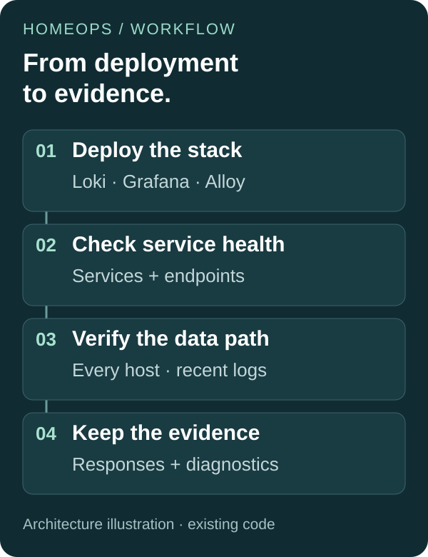

# HomeOps

### Infrastructure changes with an observable outcome.

An earlier personal infrastructure project by **Yifang Li**, built around Ansible, GitHub Actions, and the Loki / Grafana / Alloy stack. HomeOps brought deployment, service checks, log verification, and diagnostic evidence into one workflow.

**Historical project · No longer in active use**

[Read the engineering walkthrough](docs/showcase/README.md) · [Inspect the implementation](playbooks/tests/verify_observability.yml) · [历史中文操作指南](docs/history/OPERATING-GUIDE.zh-CN.md)

## From configuration to confidence

Installing a service answers only part of the operational question. HomeOps also checked whether the service was running, its endpoint responded, and logs from the expected machines actually reached the logging system.

| Step | What the implementation does | Read the source |
| --- | --- | --- |
| **01 — Deploy** | Configure Loki and Grafana on the controller, and Alloy on Linux hosts. | [Deployment playbook](playbooks/deploy-observability-stack.yml) |
| **02 — Check** | Inspect service state and enablement; probe Loki readiness and Grafana health. | [Verification playbook](playbooks/tests/verify_observability.yml) |
| **03 — Verify data** | Query journal logs, match expected hosts, and check the newest entry against a 600-second freshness limit. | [Acceptance specification](docs/verification-spec.md) |
| **04 — Diagnose** | Save service facts, HTTP responses, and per-host log summaries; capture service journals on a failed service assertion. | [Failure handling](playbooks/tests/tasks/verify_required_service.yaml) |

The result is a reviewable path from a configuration change to explicit checks and diagnostic files. The [walkthrough](docs/showcase/README.md) follows both a normal verification path and a missing-host failure.

## Engineering choices worth exploring

- **Check the outcome at several levels.** A running process, a reachable endpoint, and fresh logs from every expected host answer different questions.
- **Make the acceptance criteria explicit.** Required hosts come from inventory; log age and missing-host checks are encoded in the verifier.
- **Keep evidence when checks fail.** Service-journal capture and saved query responses support diagnosis after the failed run.
- **Give operators consistent entry points.** The [Makefile](Makefile) connects tool setup, static checks, local checks, deployment, and verification.

My work on HomeOps covered infrastructure configuration, deployment automation, verification logic, and the workflow for investigating failures. The source and operating history are preserved here as an earlier engineering case study.

## Explore further

- [Engineering walkthrough and source map](docs/showcase/README.md)
- [Original operating guide and historical milestones — 中文](docs/history/OPERATING-GUIDE.zh-CN.md)
- [Verification specification](docs/verification-spec.md) and [historical automation instructions](AGENTS.md)

**Repository status.** This presentation documents the existing implementation. It does not report a new deployment or test run. The operating commands use the original inventory and self-hosted environment; read the historical guide before attempting to run them.

**License.** No open-source license has been specified. Contact the maintainer regarding reuse.
