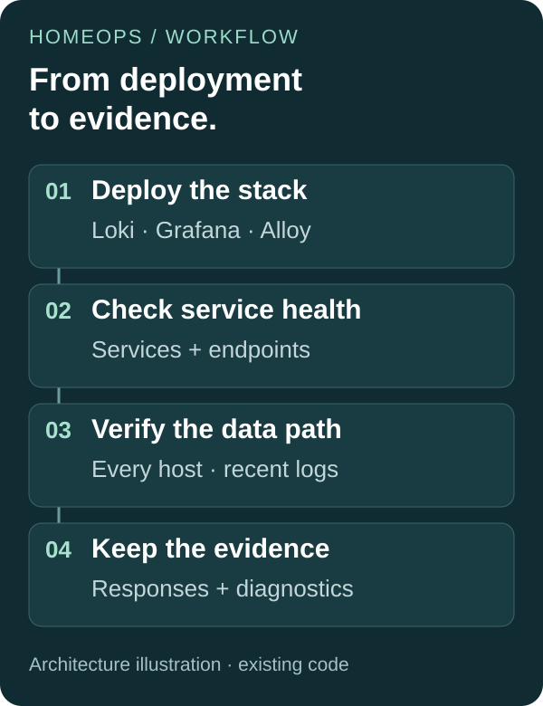

# Following a change through HomeOps

[← Project overview](../../README.md) · [Verification source](../../playbooks/tests/verify_observability.yml) · [Historical guide](../history/OPERATING-GUIDE.zh-CN.md)

## The operational question

After deploying a logging stack, can every expected machine contribute recent logs—and can an operator see what went wrong when one cannot?

HomeOps connected provisioning with checks that answer that question. This walkthrough explains the preserved implementation, using source reviewed at `d69d7c5` on November 11, 2026. The diagram is an architectural illustration, not a monitoring screenshot or a new run result.

## 01 / Establish the services

The [deployment playbook](../../playbooks/deploy-observability-stack.yml) sets up the controller's Loki and Grafana services and the Alloy collectors. Configuration templates sit alongside the playbooks, making service configuration part of the same change history.

The [Makefile](../../Makefile) separates `setup`, `lint`, `test`, `itest`, and `deploy`. Its integration target runs deployment, node preparation, and their verification against the original inventory.

## 02 / Check service health

The [verifier](../../playbooks/tests/verify_observability.yml) collects service facts and requires the relevant services to be running and enabled. It then probes Loki's readiness endpoint and Grafana's health endpoint. HTTP responses are saved for inspection.

If a required service check fails, the [service-check task](../../playbooks/tests/tasks/verify_required_service.yaml) captures its recent journal, writes an artifact, and returns failure. Capturing diagnostics does not turn the failed check into a successful one.

## 03 / Verify that logs actually arrive

The verifier queries Loki for `systemd-journal` entries over a 600-second window. It resolves expected machines from the controller and Linux inventory groups, extracts host labels from returned streams, and records the newest entry seen for each host.

Three explicit conditions matter:

1. Returned streams identify their source host.
2. Every expected host has log entries.
3. The newest entry for each required host is within the freshness limit.

The resulting host summary contains expected hosts, observed hosts, missing hosts, streams without host labels, and the freshness limit. These are inspectable data, alongside the pass/fail result.

## 04 / Follow a failure to its evidence

Consider a query that returns logs from the controller but none from another expected machine. **This is an illustrative source-level example.**

The verifier saves the query response, derives the observed-host set, writes the host summary, and fails the missing-host condition. An operator can follow that chain to distinguish incomplete collection from a wholly unavailable query endpoint.

| Diagnostic file pattern | What it helps investigate |
| --- | --- |
| `<host>_service_facts.json` | Service state and enablement |
| `<host>_loki_ready_response.json` | Loki readiness response |
| `<host>_grafana_health_response.json` | Grafana health response |
| `<host>_loki_query_response.json` | Returned log streams or query failure |
| `<host>_loki_host_summary.json` | Host coverage and log freshness |
| `<host>_<unit>_journal.log` | Journal captured after a required-service assertion fails |

The [PR workflow](../../.github/workflows/pr-quality-check.yml) uploads diagnostic artifacts even when earlier steps fail. A separate [artifact retriever](../../.github/workflows/gate2-artifact-retriever.yml) looks for available Gate2 artifacts after a failed Gate2 job and republishes them for investigation.

## What to take from this project

HomeOps shows the connection between infrastructure configuration, explicit acceptance criteria, and failure diagnosis. Its most useful reading path is **deployment → verification → saved evidence**, rather than a list of tools.

## History and validation scope

HomeOps is no longer in active use. Its earlier operating guide and milestones remain available in the [historical documentation](../history/OPERATING-GUIDE.zh-CN.md), and the original code remains unchanged by this presentation update.

This walkthrough is a source-backed explanation. No infrastructure was provisioned or tested for the documentation update, and no illustrative example is presented as a captured run. The historical inventory, workflows, and tool requirements remain in the repository for context.
